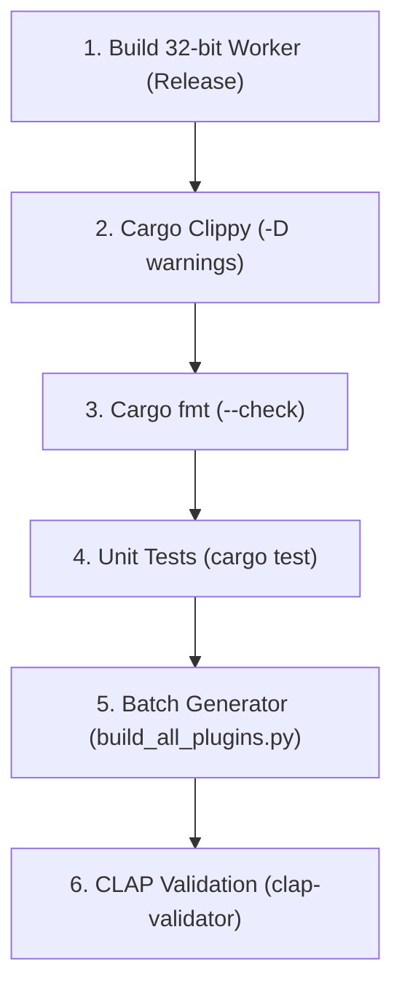

# Zoom ZFX Codebase Modernization & Architecture Playbook

This skill provides the comprehensive operational procedures, lint enforcement gates, iterator optimization patterns, and architectural migration rules established during the modernization of the Zoom ZFX codebase (`zfx-bootstrap` and `zfx-worker32`).

---

## 1. System Architecture & Targets

The codebase is split into two complementary Rust packages with distinct architecture targets:

1. **`zfx-bootstrap` (Native 64-bit Linux CLAP Plugin)**:
   - Implements the CLAP audio effect interface using `clack-plugin`, `clack-extensions`, and `baseview` + `egui` GUI.
   - Built with the default Nix shell: `nix develop`.
   - Embeds the compiled 32-bit worker executable and the legacy Windows DSP DLL payloads via `include_bytes!`.
   - Supervises child worker processes and communicates across memory-mapped POSIX shared memory (`ZfxSharedBridge`) using Linux `futex` signaling.

2. **`zfx-worker32` (32-bit i686 In-Memory PE Host)**:
   - Implements the in-memory Windows PE loader (`peldr.rs`), hardware USB dongle hot-patching, Win32 TEB LDT setup, and VST 2.4 host callback dispatcher.
   - Built with the 32-bit Nix shell: `nix develop .#shell32`.
   - Operates strictly in 32-bit mode with SSE FTZ/DAZ denormal flushing and dual-DSP true-stereo routing.

---

## 2. Clippy & Rustc Lint Hardening Policy

Both `zfx-bootstrap/Cargo.toml` and `zfx-worker32/Cargo.toml` enforce workspace-level strict linting. Every modification must build with **0 errors and 0 warnings** under `cargo clippy --all-targets --all-features -- -D warnings`.

### 2.1 Essential Lint Configuration

```toml
[workspace.lints.rust]
# Catches unconsumed lazy iterators entirely
unused_must_use = "deny"

[workspace.lints.clippy]
pedantic = { level = "warn", priority = -1 }
nursery = { level = "warn", priority = -1 }

# Loop Habits & Iterators
needless_range_loop = "deny"
manual_memcpy = "deny"
explicit_iter_loop = "deny"
explicit_into_iter_loop = "deny"
while_let_on_iterator = "deny"
iter_next_loop = "deny"
never_loop = "deny"
manual_find = "warn"
manual_filter_map = "warn"
manual_flatten = "warn"
iter_skip_next = "deny"
filter_next = "deny"
search_is_some = "deny"

# Pointer & Cast Clutter
as_conversions = "deny"
cast_lossless = "deny"
cast_possible_truncation = "deny"
cast_possible_wrap = "deny"
cast_precision_loss = "deny"
cast_sign_loss = "deny"
cast_ptr_alignment = "deny"
ptr_as_ptr = "deny"
undocumented_unsafe_blocks = "deny"

# Memory Overhead
redundant_clone = "deny"
clone_on_copy = "deny"
unnecessary_to_owned = "deny"
needless_pass_by_value = "deny"
```

### 2.2 Structural Thresholds (`clippy.toml`)

Ensure both crates retain matching `clippy.toml` files:

```toml
cognitive-complexity-threshold = 25
too-many-lines-threshold = 500
too-many-arguments-threshold = 7
type-complexity-threshold = 250
```

---

## 3. Targeted Iterator & Real-Time Refactoring Playbook

When auditing and modernizing loops and chains, apply these proven patterns:

### 3.1 Eager Consumers for Lazy Chains
Rust iterators are lazy. Any transformation of C++ loops into iterator chains must have an explicit, eager consumer:
- `.collect()`: For transforming into collections (`Vec`, `HashMap`).
- `for item in iterator`: For performing operations or side-effects.
- `.for_each(...)`: For declarative terminal execution.
- `.count()` / `.fold()`: For aggregation.

### 3.2 Chain Optimizations
- **Filter-Next to Find**: Replace `.filter(predicate).next()` with `.find(predicate)`.
- **Search-is-Some to Any**: Replace `.find(predicate).is_some()` with `.any(predicate)`.
- **While-Count to Take-While**:
  ```rust
  // Modernized probe loop
  let count = (0..256)
      .take_while(|&count| find_frame_asset(base, count).is_some())
      .count();
  count.max(1)
  ```
- **Range Indexing to Zip**:
  ```rust
  // Safe bounded slot assignment without manual index bounds checking
  for (i, param_slot) in (0..inst_l.num_params()).zip(bridge.params.iter_mut()) {
      *param_slot = meta;
  }
  ```
- **Slice Sub-ranges**: Replace `for i in 0..num_chgs { let c = arr[i]; }` with `for &c in &arr[..num_chgs]`.
- **Manual Search Loops to `find_map`**:
  ```rust
  let loaded = candidates.iter().find_map(|cand| {
      let bytes = find_asset(cand)?;
      let tex = load_texture(ctx, "bkgd", bytes)?;
      Some((cand, tex))
  });
  ```

### 3.3 Side-Effect Isolation
Never introduce side-effects (e.g. `eprintln!`, map insertion, queue modification) inside `.map()` or `.filter()` closures. Isolate searches with pure predicates (`find_map`), and execute side-effects in the consumer block.

### 3.4 Real-Time Audio Thread Allocation Law
- **Zero Allocations in Audio Callbacks**: Never allocate (`Vec::with_capacity`, `.collect()`, `String::new()`, `Box::new()`) inside `process()` or `flush()`.
- **Stack Buffering**:
  ```rust
  // Real-time safe stereo channel pair storage without heap allocation
  let mut pairs: [Option<clack_plugin::process::audio::ChannelPair<'_, f32>>; 2] = [None, None];
  let mut num_pairs = 0;
  for (slot, pair) in pairs.iter_mut().zip(channel_pairs) {
      *slot = Some(pair);
      num_pairs += 1;
  }
  ```

### 3.5 Build Script (`build.rs`) Code Generation & Cognitive Complexity
- **Cognitive Complexity Ceiling**: Strict Clippy rules enforce a maximum cognitive complexity of 15–25. In asset collection routines (`build_asset_map`), never repeat string permutations across separate scan passes. Factor insertion helpers (`insert_asset_variants(&mut map, key, value)`) to maintain clean, auditable build scripts.
- **Plugin-Local vs. Common Asset Precedence**: When collecting assets for a plugin, plugin-local files must strictly override generic `assets/Common/` root aliases regardless of case differences (e.g., local `knob00.png` vs. common `Knob00.png`). Filter out shadowed common root assets during `build_asset_map` so generic 45x45 Common knobs never shadow custom-sized plugin knobs (such as Tangerine's 54x53 black Orange-style knobs).
- **`CenterX` and `CenterY` Layout Semantics**: In `EfxType.xml`, `CenterX` and `CenterY` define the center of the control knob cap relative to the top-left `(PosX, PosY)`, accounting for asymmetric drop shadows in sprite frames. The original Zoom engine uses `(PosX + CenterX, PosY + CenterY)` for radial mouse hit-testing (`dx*dx + dy*dy <= r*r`). Deserializing these into `Ctrl` preserves layout fidelity.
- **Collapsible String Replacements**: Replace consecutive `str::replace` invocations with a slice pattern to avoid `clippy::collapsible_str_replace`:
  ```rust
  // Good: Single-pass pattern array replacement
  let normalized = raw.replace(['\\', ':'], "/");
  ```
- **Deduplication in Match Arm Code Generation**: When generating static `match` patterns for `include_bytes!`, group all aliases by canonical filesystem path and call `keys.dedup()` to ensure match pattern arms remain compact and valid.

### 3.6 Static Asset Lookup Unit Testing
Always include automated regression tests in `lib.rs` verifying that shared VFS assets, frame probing, and layout coordinate deserialization behave deterministically across builds:
```rust
#[test]
fn test_common_assets_lookup() {
    assert!(gui::find_frame_asset("Common:Knob", 0).is_some());
    assert!(gui::find_frame_asset("Common:FootSw", 0).is_some());
    assert_eq!(gui::probe_frame_count("Common:Knob", None), 49);
    assert_eq!(gui::probe_frame_count("Common:FootSw", None), 2);
}

#[test]
fn test_ctrl_center_deserialization() {
    let xml = r#"<Ctrl index="0" type="dsp" prm="1"><Type>Knob</Type>Knob</Img><PosX>312</PosX><PosY>124</PosY><Width>54</Width><Height>53</Height><CenterX>24</CenterX><CenterY>23</CenterY></Ctrl>"#;
    let ctrl: Ctrl = quick_xml::de::from_str(xml).unwrap();
    assert_eq!(ctrl.center_x, Some(24.0));
    assert_eq!(ctrl.center_y, Some(23.0));
}
```

---

## 4. Ecosystem Crate vs. `std` vs. Custom Strategy

| Pattern / Component | Strategy | Implementation |
| :--- | :--- | :--- |
| **Bitflags & Masks** | **Migrate to `bitflags` (v2.x)** | Used in `peldr.rs` for `VstTimeInfoFlags` (`TRANSPORT_PLAYING`, `TEMPO_VALID`, etc.). |
| **Shared Memory PODs** | **Migrate to `zerocopy` (v0.8)** | Derive `FromBytes, IntoBytes, KnownLayout, Immutable` on `ParamChange` & `ParamMeta`. |
| **Cross-Process Sync** | **Keep `std` (`AtomicU32` + `libc::SYS_futex`)** | Cross-process shared memory cannot host `parking_lot` / `crossbeam` user pointers. |
| **Worker CLI** | **Keep `std` (`std::env::args()`)** | Avoids 500 KB binary bloat from `clap` in embedded 32-bit worker payload. |
| **PE Loader & Relocations** | **Keep Custom (`peldr.rs`)** | `goblin` parses but cannot map/relocate executable memory on Linux i686. |
| **Dongle Hot-Patching** | **Keep Custom (`peldr.rs`)** | Byte signature scan and `ret` patch preserving `__cdecl` stack balance. |
| **Win32 TEB LDT Setup** | **Keep Custom (`peldr.rs`)** | `SYS_set_thread_area` LDT descriptor + inline asm `FS` register switcher. |
| **Dual-DSP Routing** | **Keep Custom (`main.rs`)** | Synchronized dual-mono instantiation for true stereo processing. |

### 4.1 Static Assertions for Cross-Target Consistency
Always verify that shared IPC structures maintain identical size and alignment across 32-bit and 64-bit targets:
```rust
const _: () = assert!(std::mem::size_of::<ParamChange>() == 8);
const _: () = assert!(std::mem::align_of::<ParamChange>() == 4);
const _: () = assert!(std::mem::size_of::<ParamMeta>() == 40);
const _: () = assert!(std::mem::align_of::<ParamMeta>() == 4);
```

---

## 5. Verification & Packaging Execution Pipeline

Follow this sequential terminal checklist to audit, compile, and validate all plugins:



### Step 1: Rebuild 32-bit Worker (Release)
```bash
nix develop .#shell32 --command cargo build --manifest-path zfx-worker32/Cargo.toml --release
```

### Step 2: Strict Clippy Audit on All Targets
```bash
# 64-bit bootstrap
nix develop --command cargo clippy --manifest-path zfx-bootstrap/Cargo.toml --all-targets --all-features -- -D warnings

# 32-bit worker
nix develop .#shell32 --command cargo clippy --manifest-path zfx-worker32/Cargo.toml --all-targets --all-features -- -D warnings
```

### Step 3: Formatting Normalization Check
```bash
nix develop --command cargo fmt --manifest-path zfx-bootstrap/Cargo.toml -- --check
nix develop .#shell32 --command cargo fmt --manifest-path zfx-worker32/Cargo.toml -- --check
```

### Step 4: Unit Test Execution
```bash
nix develop --command cargo test --manifest-path zfx-bootstrap/Cargo.toml
nix develop .#shell32 --command cargo test --manifest-path zfx-worker32/Cargo.toml
```

### Step 5: Batch Plugin Generation & Installation
Rebuilds and packages all 93 DSP and utility plugins into self-contained `.clap` bundles:
```bash
nix develop --command python3 build_all_plugins.py --include-internal --install
```

### Step 6: Automated CLAP Compliance Validation
```bash
nix develop --command ./clap-validator/target/release/clap-validator validate ~/.clap/100BassMan.clap
```
*Expected result: 33 passed, 0 failed, 0 warnings.*
