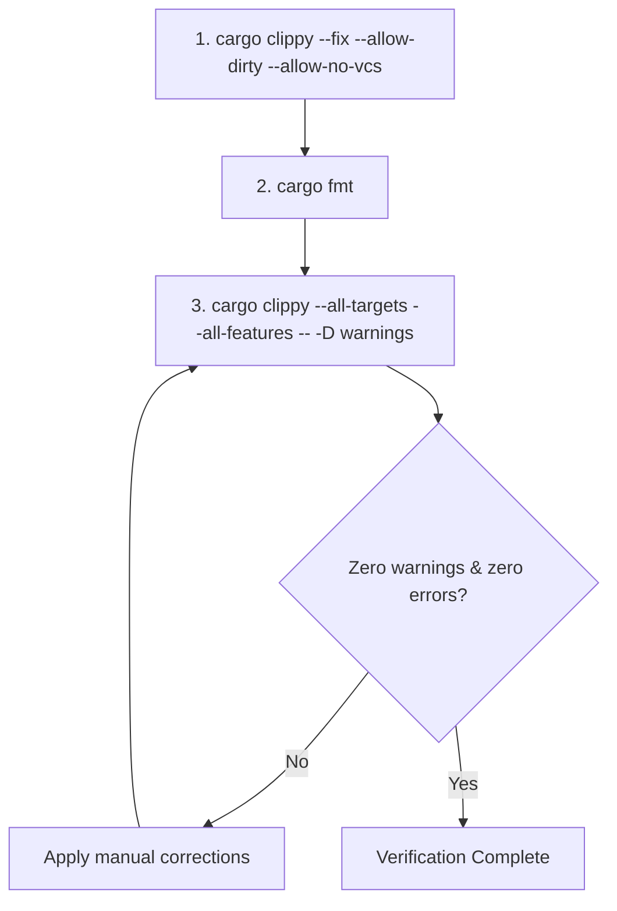

# GUIDELINES.md

## Operational Directives for Codebase Modernization ("Janitor Agent")

This document serves as the strict operational specification for the Janitor Agent. The mission is to refactor raw, decompiled, C++-style Rust code into safe, modern, and idiomatic Rust without changing functional behavior.

---

### 1. The Mission

| Dimension | Decompiled Input State (Source) | Modernized Output State (Target) |
| :--- | :--- | :--- |
| **Paradigm** | Procedural, C++-style imperative logic | Functional & expressive idiomatic Rust |
| **Safety** | Pervasive `unsafe`, raw pointer arithmetic | Safe abstractions; isolated, minimal `unsafe` |
| **Memory Model** | Manual offsets, indexing, raw buffer manipulation | Safe slices (`&[T]`, `&mut [T]`), smart pointers |
| **Control Flow** | Deeply nested `if/else`, sentinel return codes | Pattern matching (`match`, `if let`), `Result`/`Option` |
| **Error Handling** | Integer return codes (`0`, `-1`, HRESULTs) | Strongly typed `Result<T, E>` |

---

### 2. Crate Replacement & Adoption Filter

Identify custom-implemented boilerplate or inlined algorithms that match common utility patterns and replace them with standard crates from [crates.io](https://crates.io).

#### 2.1 Vetting & Adoption Matrix

| Domain | Target Decompiled Pattern | Approved De Facto Crate | `std` Fallback (If Crate Rejected) |
| :--- | :--- | :--- | :--- |
| **Bitflags & Masks** | `const FLAG_A: u32 = 1 << 0;`, manual `&`, `\|`, `^` | `bitflags` | Bitwise operators on primitive types (`u32`, `u64`) |
| **Transmutation & Casts** | `*(T*)&bytes`, pointer casts, raw byte transmutes | `zerocopy`, `bytemuck` | Native methods (`to_le_bytes`, `from_le_bytes`) |
| **Endianness & Parsing** | `(b[0] as u32) \| ((b[1] as u32) << 8)`, manual parsing | `byteorder`, `scroll` | `u16::from_le_bytes`, `u32::from_le_bytes`, etc. |
| **Hashing & Cryptography**| Inlined SHA, AES, CRC, MD5 loops | RustCrypto (`sha2`, `aes`, `crc32fast`) | Preserve decompiled logic in isolated module |
| **Serialization** | Manual struct-to-slice serializers/deserializers | `serde`, `bincode` | Safe `std::io::Read` and `std::io::Write` traits |
| **CLI / Argument Parsing** | Manual iteration over `argv`, slicing strings | `clap` | `std::env::args()` with iterator combinators |
| **Ring Buffers & Queues** | Manual atomic ring buffers, spinlocks | `crossbeam`, `tokio` (async) | `std::sync::mpsc`, `std::sync::atomic`, `Mutex` |

#### 2.2 Strict Vetting Filter & Rejection Rule

- **Acceptance Criterion:** A crate MUST be a widely recognized, high-adoption standard (>100k downloads or official ecosystem standard).
- **CRITICAL EXCEPTION:** If a crate is obscure, unmaintained, a dead repository, has few stars, or is hyper-niche, **DO NOT ADD IT**. Keep the raw decompiled implementation intact or refactor it using standard library (`std`) primitives instead.

---

### 3. Idiomatic Refactoring Directives

#### 3.1 Loop Modernization

Replace raw counter loops and index-based slice access with safe iterator chains.

| Anti-Pattern (C++-esque) | Idiomatic Rust | Rationale |
| :--- | :--- | :--- |
| `for i in 0..items.len() { process(items[i]); }` | `for item in &items { process(item); }` | Eliminates manual bounds checking; idiomatic borrowing |
| `for i in 0..len { dst[i] = src[i]; }` | `dst[..len].copy_from_slice(&src[..len]);` | Leverages SIMD / `memcpy` intrinsics |
| `let mut i = 0; while i < v.len() { if pred(v[i]) { ... } i += 1; }` | `for item in v.iter().filter(\|x\| pred(x)) { ... }` | Replaces imperative loop state with declarative filters |
| `let mut idx = 0; for x in list { use(x, idx); idx += 1; }` | `for (idx, x) in list.iter().enumerate() { use(x, idx); }` | Avoids separate mutable counter state |

#### 3.2 Safety & Pointer Elimination

Minimize `unsafe` blocks. Convert raw pointers (`*const T`, `*mut T`) into safe slices or RAII constructs.

| Anti-Pattern (C++-esque) | Idiomatic Rust | Rationale |
| :--- | :--- | :--- |
| `let ptr = buf.as_ptr(); unsafe { *ptr.offset(4) }` | `buf[4]` or `buf.get(4).copied()` | Safe bounds verification, zero pointer arithmetic |
| Raw pointer pairs `(ptr, len)` passed between functions | `&[T]` or `&mut [T]` | Rust slices encapsulate pointer and length with lifetime tracking |
| Sentinel null pointer checks (`ptr.is_null()`) | `Option<&T>` or `Option<NonNull<T>>` | Compile-time null-safety without runtime hazards |
| Manual memory allocation and manual free | `Box<T>`, `Vec<T>`, or RAII wrappers implementing `Drop` | Prevents use-after-free and memory leaks |

Every remaining `unsafe` block must include a preceding `// SAFETY:` comment justifying its validity:
```rust
// SAFETY: The caller guarantees that `ptr` is aligned, non-null, and points
// to an initialized `Header` struct that outlives this function call.
let header = unsafe { &*ptr.cast::<Header>() };
```

#### 3.3 Control Flow & Type System

Eliminate integer error codes and nested conditionals in favor of algebraic types.

| Anti-Pattern (C++-esque) | Idiomatic Rust | Rationale |
| :--- | :--- | :--- |
| `if status == 0 { ... } else if status == 1 { ... } else { ... }` | `match status { Status::Ok => ..., Status::Pending => ..., _ => ... }` | Exhaustiveness checking; clearer intent |
| Return code integer (`0` on success, `< 0` on failure) | Return `Result<T, E>` | Forces explicit error handling via `?` operator |
| Magic sentinel values (`-1`, `0xFFFFFFFF`) | Return `Option<T>` | Eliminates in-band error signals |
| Nested guard blocks: `if p != null { if len > 0 { ... } }` | `guard` style with `let Some(...) = ... else { return; };` | Flattens control flow; reduces indentation drift |

---

### 4. Verification Pipeline

The Janitor Agent must execute the following sequential terminal checklist. Work is not complete until every stage passes cleanly.



#### Sequential Checklist

1. **Automated Mechanical Fixes:**
   ```bash
   cargo clippy --fix --allow-dirty --allow-no-vcs
   ```
   *Automatically resolves straightforward compiler warnings (redundant clones, unneeded borrows, needless `return`).*

2. **Formatting Normalization:**
   ```bash
   cargo fmt
   ```
   *Restores standard Rust code layout, line wrapping, and indentation.*

3. **Strict Lint Enforcement Gate:**
   ```bash
   cargo clippy --all-targets --all-features -- -D warnings
   ```
   *Hard gate: treats all warnings as fatal errors. The agent must recursively fix violations until the codebase builds with **0 errors and 0 warnings**.*

---

### 5. Definition of Done (DoD)

- [ ] All raw indexing loops (`for i in 0..len`) replaced by iterators, `.copy_from_slice()`, or slice indexing.
- [ ] Raw pointers converted to `&[T]`, `&mut [T]`, or smart pointers; all surviving `unsafe` blocks contain `// SAFETY:` justifications.
- [ ] C-style integer return codes and magic numbers converted to `Result` and `Option`.
- [ ] Custom boilerplate replaced only with approved, de facto standard crates or `std` equivalents.
- [ ] Verification pipeline executed: `cargo clippy --fix`, `cargo fmt`, and `cargo clippy --all-targets --all-features -- -D warnings` passes with **0 errors and 0 warnings**.
